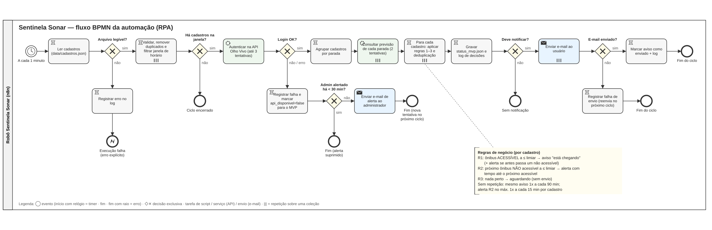
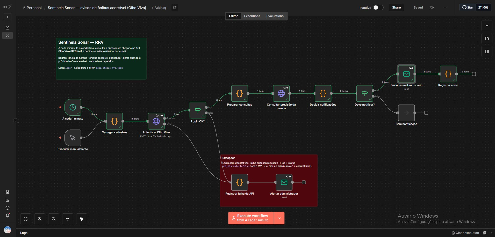
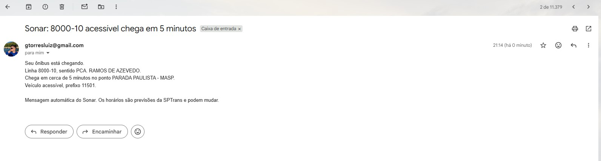
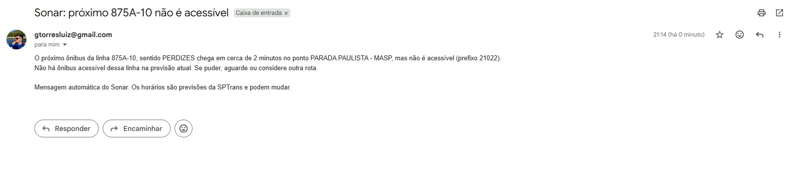
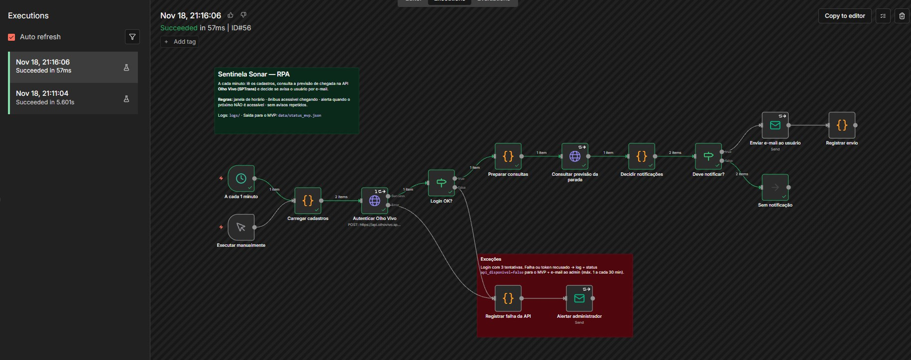
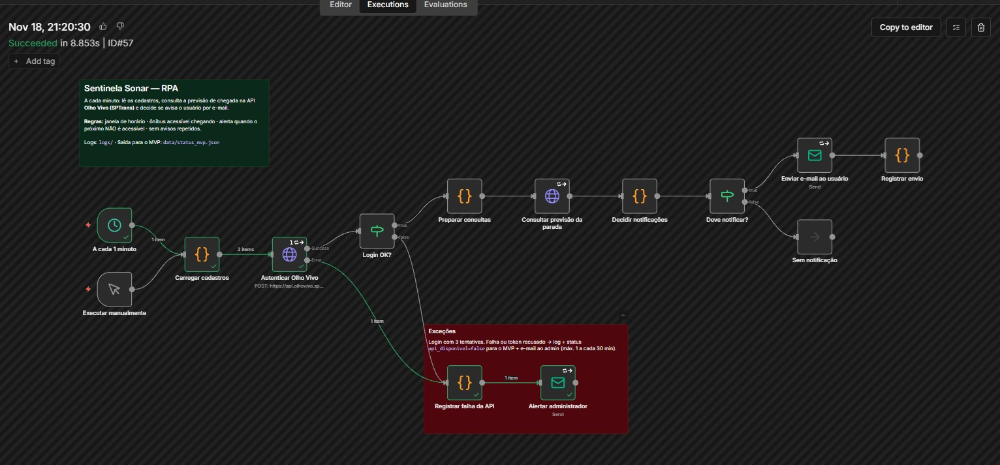
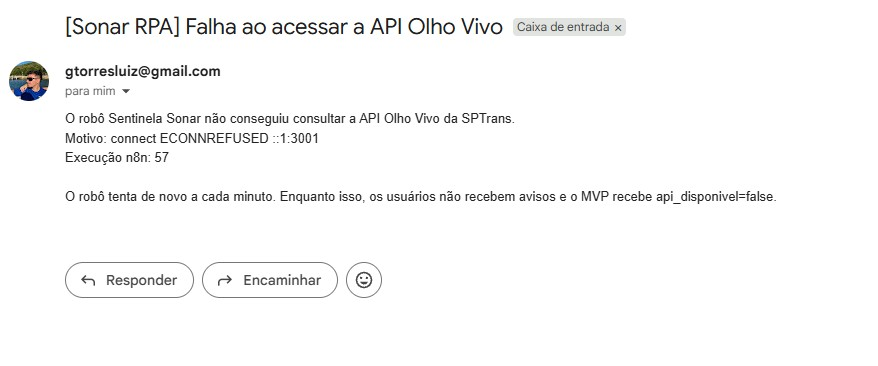
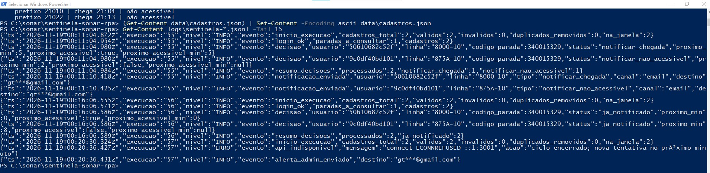

# Sentinela Sonar — RPA de avisos de ônibus acessível

Automação da **Global Solution 2026.2 (FIAP · CitizenTech · Engenharia de Software 4º ano)**, disciplina de *Robotic Process Automation*, parte do projeto **Sonar**: um assistente de mobilidade para pessoas cegas ou com deficiência visual no transporte público de São Paulo.

## Integrantes

| Nome | RM |
|---|---|
| Gabriel Torres Luiz | 98600 |
| Eduardo Fedeli Souza | 550132 |
| Otavio Vitoriano da Silva | 552012 |
| Rodrigo Resende Viana | 551057 |
| Caíque Chagas Nitta | 551943 |

### ▶️ **Vídeo de demonstração:** https://www.youtube.com/watch?v=WyijKzd8340
### ▶️ **Vídeo do projeto:** https://www.youtube.com/watch?v=WN7GGS0Ydko

## Problema

Uma pessoa cega no ponto de ônibus não consegue ler o letreiro nem saber se o veículo que está chegando tem acessibilidade (piso baixo/elevador). Hoje, ela precisa perguntar a desconhecidos ou consultar aplicativos visuais repetidas vezes. É um processo manual, cansativo e pouco seguro.

## O que a automação faz

Um robô no **n8n** roda **a cada minuto** e:

1. Lê os trajetos cadastrados pelos usuários (parada, linha, sentido, janela de horário e antecedência desejada).
2. Valida os cadastros, descarta os inválidos e remove os duplicados.
3. Autentica na **API Olho Vivo da SPTrans** e consulta a previsão de chegada em cada parada, com uma chamada por parada, mesmo que vários usuários usem a mesma.
4. Aplica as regras de negócio para cada cadastro:
   - **Regra 1 — Chegando:** se um ônibus **acessível** chega dentro da antecedência do usuário, envia o aviso. Se antes dele passar um ônibus não acessível da mesma linha, o aviso também diz isso.
   - **Regra 2 — Não acessível:** se o próximo ônibus está perto mas **não é acessível**, envia um alerta com o tempo até o próximo acessível, ou informa que não há nenhum acessível na previsão.
   - **Regra 3 — Aguardando:** nada perto o suficiente, então não envia nada.
   - **Sem repetição:** o mesmo aviso não é reenviado por 90 minutos, e o alerta de "não acessível" sai no máximo uma vez a cada 15 minutos por cadastro.
5. Envia o aviso por **e-mail** em texto simples, pensado para leitores de tela: a informação principal vem primeiro, sem imagens nem tabelas.
6. Grava **logs de auditoria** e um **arquivo de status estruturado** (`data/status_mvp.json`) que o MVP do Sonar consome.

> **Próxima versão:** envio pelo **WhatsApp** (WhatsApp Cloud API da Meta), que é o canal mais usado pelo público-alvo e funciona bem com TalkBack e VoiceOver. A troca afeta só o nó de envio; as regras e os logs continuam iguais.

## Arquitetura

```
 [Agendamento 1 min] ─┐
 [Execução manual] ───┴─► Carregar cadastros ─► Autenticar Olho Vivo ─► Login OK? ──sim──► Preparar consultas
                          (valida, deduplica,    (3 tentativas)            │                 (agrupa por parada)
                           filtra janela)                                  não                     │
                                                                           ▼                       ▼
                                                              Registrar falha da API     Consultar previsão da parada
                                                              (log + status offline       (2 tentativas por parada)
                                                               + alerta ao admin)                  │
                                                                           │                       ▼
                                                                           ▼             Decidir notificações (laço + regras)
                                                              Alertar administrador      ├─ grava data/status_mvp.json
                                                                                         ▼
                                                                                  Deve notificar? ──sim──► Enviar e-mail ─► Registrar envio
                                                                                         └──não──► Sem notificação
```

| Componente | Tecnologia | Justificativa |
|---|---|---|
| Orquestração | n8n 1.x (self-hosted via `npx`) | Gratuito, visual, com agendamento, HTTP, retentativas e e-mail nativos. O fluxo é exportado em JSON e versionado no Git. |
| Fonte de dados | API Olho Vivo v2.1 (SPTrans) | Previsões em tempo real e o campo `a` (veículo acessível) para cada ônibus. |
| Regras de negócio | JavaScript (nós Code) | Mesmo código em `src/sentinela-core.js`, testado automaticamente fora do n8n. |
| Notificação | E-mail (SMTP) | Funciona com qualquer leitor de tela; WhatsApp fica para a próxima versão. |
| Integração com o MVP | Arquivo JSON estruturado | `data/status_mvp.json`, com o contrato descrito em [`docs/contrato-saida-mvp.md`](docs/contrato-saida-mvp.md). |

## Estrutura do repositório

```
n8n/       workflow exportado (importar no n8n)
src/       núcleo de regras (sentinela-core.js), I/O, código de cada nó, build e utilitário de busca de paradas
docs/      fluxo BPMN (sentinela-sonar.bpmn + PNG), contrato da saída para o MVP
assets/    prints do fluxo e evidências
logs/      amostras de log SEM dados sensíveis (logs/amostras/)
tests/     testes automatizados, simulação de ponta a ponta e RESULTADOS.md
data/      cadastros.exemplo.json (os arquivos reais ficam fora do Git)
scripts/   iniciar o n8n com as variáveis corretas (Windows e Linux/macOS)
```

## Como executar

**Pré-requisito:** Node.js 18 ou mais novo.

1. **Configure o `.env`**: copie `.env.example` para `.env` e preencha o token do Olho Vivo e os e-mails. O `.env` nunca vai para o Git.
2. **Descubra a parada** e teste o token:
   ```bash
   node src/buscar-parada.js "Paulista"            # lista códigos de parada
   node src/buscar-parada.js --previsao 340015329  # linhas e veículos previstos, com acessibilidade
   ```
3. **Edite `data/cadastros.json`** com os seus trajetos. Na primeira execução, o script cria esse arquivo a partir do exemplo.
4. **Inicie o n8n**:
   - Windows: `powershell -ExecutionPolicy Bypass -File scripts\iniciar-n8n.ps1`
   - Linux/macOS: `./scripts/iniciar-n8n.sh`

   Depois, abra http://localhost:5678 e crie o usuário local.
5. **Crie a credencial SMTP** no n8n em *Credentials → New → SMTP*. Para Gmail:
   - host `smtp.gmail.com`, porta `465`, SSL ligado
   - usuário: seu e-mail
   - senha: uma **senha de app** (Conta Google → Segurança → Verificação em duas etapas → Senhas de app)
6. **Importe o fluxo** em *Workflows → Import from file → `n8n/sentinela-sonar.workflow.json`*. Em seguida, abra os nós **Enviar e-mail ao usuário** e **Alertar administrador** e selecione a credencial SMTP.
7. Teste com **Execute workflow** (gatilho manual). Para deixar o robô rodando a cada minuto, ative o fluxo com o botão **Active**.

### Modo simulação (sem depender da chave da SPTrans)

`src/mock-olhovivo.js` é um simulador local da API Olho Vivo v2.1, com os mesmos endpoints e o mesmo formato de resposta. A frota simulada mistura ônibus acessíveis e não acessíveis, e as previsões mudam a cada minuto. Ele foi usado na demonstração enquanto a chave da SPTrans aguardava liberação.

```powershell
node src/mock-olhovivo.js                     # terminal separado; deixe aberto
# no .env: OLHOVIVO_BASE_URL=http://localhost:3001/v2.1
# para simular a API fora do ar:  $env:MOCK_CENARIO="fora"; node src/mock-olhovivo.js
```

Para voltar à API real, basta trocar `OLHOVIVO_BASE_URL` no `.env` e reiniciar o n8n.

### Como forçar cada cenário para a demonstração

| Cenário | Como provocar |
|---|---|
| Aviso de chegada | Use uma parada e linha com ônibus circulando e `limiar_min` alto (ex.: 30). |
| Ônibus não acessível | Escolha uma linha com frota mista (veja com `--previsao`). |
| Sem repetição | Execute duas vezes seguidas: na segunda, o log mostra `ja_notificado`. |
| API fora do ar | No `.env`, troque `OLHOVIVO_BASE_URL` por `http://api.invalido.local` e reinicie o n8n. |
| Token recusado | No `.env`, troque `OLHOVIVO_TOKEN` por um valor qualquer e reinicie o n8n. |
| Cadastro inválido ou duplicado | Coloque um e-mail sem `@` ou repita um cadastro em `data/cadastros.json`. |

## Exceções e resiliência

| Falha | Tratamento |
|---|---|
| API fora do ar ou lenta | Login com 3 tentativas (intervalo de 3 s) e timeout de 10 s. Depois disso: log `api_indisponivel`, `status_mvp.json` com `api_disponivel=false` (mantendo o último dado válido) e e-mail ao administrador, no máximo 1 a cada 30 min. Nova tentativa no próximo ciclo. |
| Token inválido | O login retorna `false`, o fluxo segue para o mesmo caminho de falha e o motivo fica no log. |
| Falha em uma parada | 2 tentativas. Se ainda falhar, só os cadastros dessa parada ficam como `erro_consulta`; as demais seguem normalmente. |
| Resposta inconsistente | Sem horário, previsão nula ou veículo com horário inválido ou repetido: o dado é descartado e registrado (`resposta_inconsistente`, `sem_previsao`). |
| Cadastro inválido ou duplicado | Registrado com o motivo (`cadastro_invalido`); duplicados são removidos e contados. |
| Arquivo de cadastros ausente ou corrompido | A execução falha **de forma explícita** (aparece como erro no n8n) e o motivo fica no log. |
| E-mail não enviado | 2 tentativas. O aviso **não** é marcado como enviado, então o robô tenta de novo no próximo ciclo. |
| Gravação de arquivo | Escrita atômica (`.tmp` e depois renomeia) para não corromper o estado. |

## Logs e auditoria

Os logs ficam em `logs/sentinela-AAAA-MM-DD.jsonl`, com um evento JSON por linha. Cada linha traz data/hora, ID da execução no n8n, nível, evento, itens processados e o resultado. Amostras estão em [`logs/amostras/`](logs/amostras/).

```json
{"ts":"2026-11-18T22:55:07.566Z","execucao":"1001","nivel":"INFO","evento":"decisao","usuario":"b7bed0bcb363","linha":"8000-10","codigo_parada":340015329,"status":"notificar_chegada","proximo_min":3,"proximo_acessivel":false,"proximo_acessivel_min":6}
```

## Segurança e LGPD

- **Segredos fora do código:** o token do Olho Vivo e a senha SMTP ficam no `.env` e nas credenciais criptografadas do n8n. O fluxo exportado não contém nenhum segredo.
- **Minimização:** o cadastro guarda só o necessário (e-mail, parada, linha, horário). Nenhum dado de saúde é coletado; a preferência por ônibus acessível é uma configuração do serviço.
- **Pseudonimização nos logs:** o usuário aparece como hash SHA-256 com sal (12 caracteres) e o e-mail aparece mascarado (`an***@exemplo.com`). Tokens, cookies e e-mails são removidos automaticamente das mensagens de erro (`sanitizar`).
- **Dados reais fora do repositório público:** `cadastros.json`, `estado.json` e os logs de produção estão no `.gitignore`.
- **Retenção:** o estado de deduplicação guarda chaves por no máximo 90 minutos.
- **Base legal (proposta):** consentimento do usuário no cadastro, com opção de desativar (`"ativo": false`) ou excluir o cadastro.

## Evidências

Execuções reais no n8n, com o simulador da API Olho Vivo (prints em [`assets/`](assets/)):

| Cenário | Evidência |
|---|---|
| Fluxo do BPMN |  |
| Sucesso: fluxo completo |  |
| Sucesso: e-mail de ônibus acessível chegando |  |
| Decisão: alerta de ônibus não acessível |  |
| Decisão: aviso não se repete |  |
| Falha: API fora do ar |  |
| Falha: e-mail ao administrador |  |
| Logs de auditoria |  |

## Testes

```bash
node --test tests/*.test.js     # 17 testes das regras (sucesso, decisão, falha, LGPD, MVP)
node src/build-workflow.js      # regenera o workflow a partir de src/
node tests/simular-n8n.js       # executa o código dos nós do workflow de ponta a ponta (API e SMTP simulados)
```

Os resultados estão em [`tests/RESULTADOS.md`](tests/RESULTADOS.md).

## Solução de problemas

| Mensagem | Causa e solução |
|---|---|
| `Cannot find module 'fs'` ou `access to env vars denied` | O n8n foi iniciado sem as variáveis certas. Use `scripts/iniciar-n8n.*`. |
| `SONAR_DIR não definido` | Mesma causa: inicie o n8n pelo script. |
| Login sempre `false` | Token errado ou ainda não ativado no portal da SPTrans. Confira com `node src/buscar-parada.js --previsao <parada>`. |
| E-mail não chega | Confira a senha de app do Gmail e a pasta de spam. O motivo aparece no log (`envio_falhou`). |

## Links

- Vídeo de demonstração: _(inserir link)_
- API Olho Vivo: https://www.sptrans.com.br/desenvolvedores/
